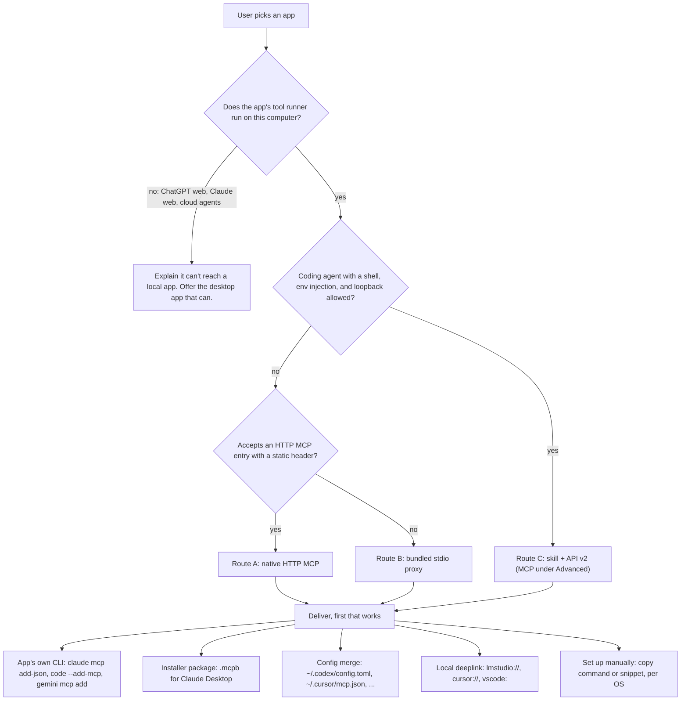
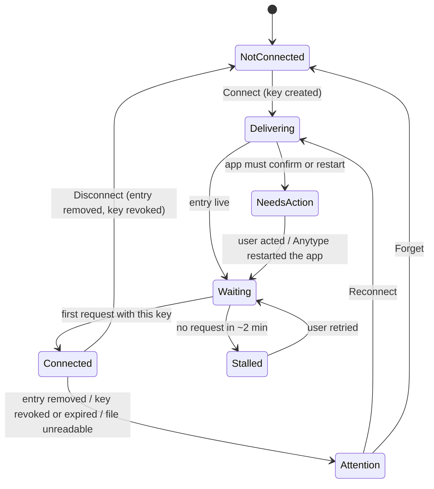
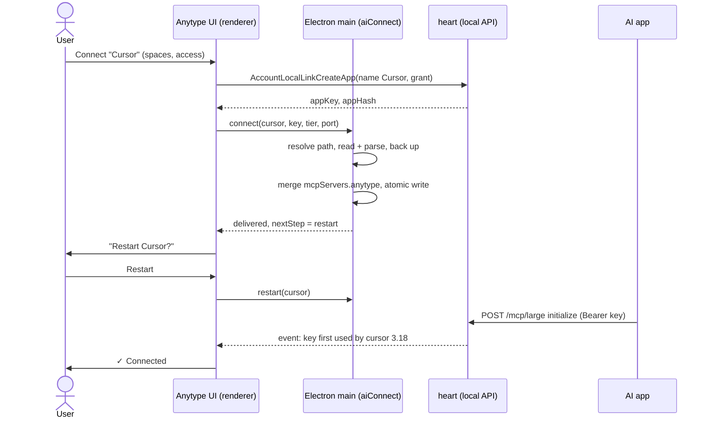

# Connect Anytype to AI apps: UX/UI proposal

Status: proposal · 2026-11-26 · base: `develop` (middleware 0.51.11, native MCP built in)

Companion documents:

- [apps.md](apps.md): the per-app playbook. What Anytype detects, writes or runs for each app on macOS, Windows and Linux.
- [architecture.md](architecture.md): components, key lifecycle, the config-writing contract, the bundled proxy, verification, and what we need from heart and anytype-mcp.
- [marketplaces.md](marketplaces.md): what each marketplace or directory (ChatGPT, Claude, LM Studio, Ollama, MCP registries) can and cannot do for a local app.
- [research/](research/): the verified per-app research reports, with sources and a CONFIRMED / CORRECTED / UNCONFIRMED log.

The research sweep ran on 2026-11-26 with 42 agents: one researcher per topic, a skeptical verifier for every app and marketplace report, and a completeness pass. It is documentation and source research, not a hands-on test of each app. Everything this proposal marks "test before ship" still needs a real run.

---

## 1. Summary

1. **One place.** Settings → **AI apps** shows a gallery of AI apps, with the ones Anytype detects on this computer at the top.
2. **One button per app: Connect.** Anytype:
   - creates an API key for that app directly over RPC (`AccountLocalLinkCreateApp`; no 4‑digit code);
   - delivers it the way that app supports best: its own CLI, its config file, its install link, or an extension package;
   - checks that the app actually reaches Anytype;
   - lists the connection, where it can be changed or removed.
3. **Nothing manual by default.** The user doesn't install Node, run npx, copy a token or edit JSON. Apps that can only launch a local process run the stdio proxy that ships inside the Anytype package. A copyable command or snippet exists only as a fallback, behind "Set up manually".
4. **Three routes under the hood, chosen per app.** The user never picks one:
   - **A. Native HTTP MCP**: the app calls `http://127.0.0.1:<port>/mcp/<tier>` with a key header. No extra process.
   - **B. Bundled stdio proxy**: for apps that only launch commands (Claude Desktop, Raycast, BoltAI).
   - **C. API v2 + `anytype-api` skill**: for coding agents with a shell, where the agent's config can carry the key (Claude Code first).
5. **Honest about what's left.** Every connection ends in one of three states: "Connected", one named action ("Click Install in Claude", "Restart Cursor"), or a plain explanation ("ChatGPT on the web can't reach apps on your computer").
6. **Marketplaces don't solve setup today.** No directory in the four ecosystems we checked can install a local-only server *and* hand it a per-user key. What to do: republish the stale MCP registry entry, update LM Studio's existing Anytype install page, run our own plugin marketplaces for the skill, and ask OpenAI about a "desktop-only" partner listing. Listing in ChatGPT's or Claude's directories needs an Anytype-hosted HTTPS + OAuth connector, which is a separate strategic project. See [marketplaces.md](marketplaces.md).

---

## 2. Target experience

```
Settings ▸ AI apps
┌──────────────────────────────────────────────────────────────────────┐
│ Connect Anytype to AI apps                                           │
│ Use your spaces in the AI app you choose. Anytype stays on this      │
│ computer; you decide which spaces each app can use.                  │
│                                                                      │
│ On this computer                                                     │
│  [◆ Claude]        Claude Desktop                         Connect    │
│  [◆ ChatGPT]       ChatGPT                                Connect    │
│  [◆ Cursor]        Cursor                    ● Connected  Manage     │
│                                                                      │
│ Other apps                                                [Search…]  │
│  Claude Code · Codex · VS Code · LM Studio · Zed · Cline · Jan · …   │
│  Ollama · Other app…                                                 │
└──────────────────────────────────────────────────────────────────────┘
```

Click **Connect** on Claude Desktop:

```
┌ Connect Claude Desktop ───────────────────────────────────────┐
│                                                               │
│  Claude can  [ read and edit ▾ ]  [ All spaces ▾ ]            │
│                                                               │
│  Anytype will add itself to Claude. Claude asks you to        │
│  confirm once.                                                │
│                                                               │
│  ▸ Advanced                                                   │
│                                       [ Cancel ] [ Connect ]  │
└───────────────────────────────────────────────────────────────┘
```

→ Claude comes to the front with its own "Install Anytype?" dialog → the user clicks **Install** →

```
┌ Claude Desktop ───────────────────────────────────────────────┐
│  ✓ Connected                                                  │
│  Claude made its first request a moment ago.                  │
│                                                               │
│  Try in Claude: "What did I write about the launch plan?"     │
│                                          [ Open Claude ] [Done]│
└───────────────────────────────────────────────────────────────┘
```

Budget per app: **2 clicks in Anytype, at most 1 click in the AI app, at most 1 restart, which Anytype offers to do itself.**

---

## 3. Principles

1. **Anytype does the setup.** The user never sees a key unless they open "Set up manually".
2. **One key per connection.** It is named after the app ("Claude Desktop"), scoped to the chosen spaces and access, and revocable. Removing the connection removes the app entry *and* revokes the key.
3. **Use the app's own mechanism first.** In order: the app's CLI, its installer or extension package, a config merge, a local deeplink, a copy-paste fallback. (The ranking comes from the precedents in [research/tech-zero-config-precedents.md](research/tech-zero-config-precedents.md): JetBrains Auto-Configure, Docker MCP Toolkit, Obsidian MCP Connector, Raycast 2.13.)
4. **Never damage another app's config.**
   - Merge only our own entry and back the file up first.
   - Write atomically and keep the file's permissions.
   - Stop and fall back to "Set up manually" if the file doesn't parse.
5. **Name the one remaining action**, and offer to do it where possible ("Restart Cursor").
6. **Verify with evidence.** Proof is the app's first request with *its* key, not a "should work now" message.
7. **Choose the tool set per app.** `large` for apps with capable cloud models; `small` for local-model hosts (LM Studio, Jan, AnythingLLM, anything reached through Ollama); `full` only under Advanced. Modern clients load tool schemas lazily, so the tier is about model capability, not context budget.
8. **Keep cards true to the product the user knows.** A ChatGPT user may not have Codex CLI, so they get separate cards, even where both read the same file (see §6).

---

## 4. The three routes

| Route | When | What the AI app gets | Process | Node needed |
|---|---|---|---|---|
| **A. Native HTTP MCP** | The app runs locally and accepts an HTTP MCP entry with a static header | `url: http://127.0.0.1:<port>/mcp/<tier>` + `Authorization: Bearer <key>` | none | no |
| **B. Bundled stdio proxy** | The app can only launch a local command (Claude Desktop, Raycast, BoltAI) | a command that runs the proxy from the Anytype package (or a `.mcpb` that bundles it) | short-lived child of the AI app | no: Electron's or Claude's built-in runtime |
| **C. API v2 + skill** | A coding agent with a shell, whose config can hand the key to its shell, and where loopback isn't sandboxed (or can be allowed) | the `anytype-api` skill in its skills folder + `ANYTYPE_API_URL` / `ANYTYPE_API_KEY` in its environment | none | no |

How Anytype picks the route:



The route is fixed per app in a declarative adapter table ([architecture.md §3](architecture.md#3-client-adapters)), so the UI never asks which route to use. Coding agents get one exception: **Advanced ▸ Connect using: Skill + API / MCP tools.**

### Why Route C exists

API v2 was designed to be agent-native. A capable coding agent composes calls, batches `PATCH` ops and keeps only the output it needs, all in one shell step. The `anytype-api` skill (`core/api/v2/SKILL.md` in heart) teaches it how. Anytype ships the skill inside the app package, so it always matches the API of the running app. Anytype gives the agent the key through the agent's own environment config. The command line references `$ANYTYPE_API_KEY`, so the model never handles the value.

Route C works zero-touch only where the agent offers three things ([research/api-skill-route.md](research/api-skill-route.md)):

| Agent | Skill folder | Key into the shell | Loopback | Route C as default? |
|---|---|---|---|---|
| Claude Code (CLI, Desktop Code tab, IDE ext.) | `~/.claude/skills/` (picked up live) | `env` in `~/.claude/settings.json` (applies however Claude Code starts) | open; sandbox off by default. If the user turns it on: `sandbox.network.allowedDomains: ["127.0.0.1:31009"]` | **Yes** |
| Codex (CLI, IDE, ChatGPT app) | `~/.agents/skills/` | `[shell_environment_policy] set = {…}` in `~/.codex/config.toml` | **blocked** by the default `workspace-write` sandbox. Allowing it opens the network for every command | No: MCP default, Route C under Advanced with a warning |
| Cursor | `~/.cursor/skills/` | none found | blocked by the default sandbox | No: MCP |
| GitHub Copilot (VS Code, CLI) | `~/.copilot/skills/` | unconfirmed | open by default | No: MCP until env injection is confirmed |
| Hermes | `~/.hermes/skills/` | `~/.hermes/.env` + `terminal.env_passthrough` | open | Either: test both |

Test before ship: a short eval comparing Route C and MCP on the same tasks in Claude Code (find, read, create, append, edit a property) before C becomes the default there.

---

## 5. App coverage

Detection, exact entries and per-OS paths are in [apps.md](apps.md). This is the product view.

### Release 1 (POC → first public release)

| Card | Route | How Anytype delivers it | Left for the user | Notes |
|---|---|---|---|---|
| **Claude Desktop** | B | Generates a per-connection `.mcpb` (proxy + key) and opens it in Claude | Click **Install** in Claude | Runs on Claude's own Node. Fallback: merge a stdio entry into `claude_desktop_config.json`, then restart |
| **Claude Code** | C (MCP under Advanced) | Copies the skill and merges `env` into `~/.claude/settings.json`. MCP: `claude mcp add-json --scope user anytype -` | Start a new session | One connection covers the CLI, the Desktop Code tab and the IDE extensions |
| **ChatGPT** (new desktop app) | A | Merges `[mcp_servers.anytype]` into `~/.codex/config.toml` | Restart ChatGPT (Anytype offers it) | Use it in **Work or Codex mode**: Chat mode currently doesn't show local tools (openai/codex#38162, open) |
| **Codex** (CLI, IDE extension) | A (C under Advanced) | Same file as ChatGPT | New session / restart extension | Shown separately from ChatGPT. Reuses the ChatGPT connection if one exists |
| **Cursor** | A | Merges `~/.cursor/mcp.json`; fallback: `cursor://` install link | Restart Cursor, then switch "anytype" on | Cursor doesn't pick up external edits to URL servers yet (confirmed bug) |
| **VS Code + GitHub Copilot** | A | Merges `~/.copilot/mcp-config.json` (read by VS Code's Copilot harness, Copilot CLI and the Copilot app) | Restart the server or start a new chat | The `vscode:mcp/install` link targets the Local harness, which is being removed (Feb 2027), so it's a fallback only |
| **LM Studio** | A, tier `small` | `lmstudio://add_mcp` link (documented with exactly our url + header shape) | Confirm in LM Studio; approve the first tool call | Fallback: merge `mcp.json` after resolving LM Studio's home folder |
| **Other app** | — | "Set up manually": URL, key and a ready snippet in 3 common formats | Paste | Also offers the 4‑digit pairing flow for apps that start pairing themselves |

### Release 2

These apps are cheap to add once the adapter table and the config writer exist. Each is one entry in the table plus a test:
- Cline (hot-reloads its file)
- Zed
- Devin Desktop (formerly Windsurf)
- JetBrains Junie
- Antigravity CLI / IDE, plus Gemini CLI for API-key users
- OpenCode
- Goose
- Kiro
- Jan
- AnythingLLM
- Raycast
- BoltAI
- Warp
- Kilo Code
- Factory Droid
- Pi
- Hermes (MCP, or the existing `anytype-hermes` gateway)
- OpenClaw

### Router cards (no setup of their own)

- **Ollama.** Ollama has no MCP client. The card says *"Ollama runs the model; pick the app you chat with"* and lists the detected apps that `ollama launch` can start: Claude Code, Codex, OpenCode and others. Connections made from this card default to tier `small`. Open WebUI gets a guided card: URL + key with copy buttons and the exact admin field names.
- **ChatGPT Classic / ChatGPT web / Claude web & mobile / Perplexity / Le Chat.** These apps run tools from the vendor's cloud and can't reach `127.0.0.1`. Say so plainly and offer the desktop app that can (the new ChatGPT desktop app, Claude Desktop).

---

## 6. Cards vs config files

Some products the user sees as separate apps share one config file:

| Shared file | Products |
|---|---|
| `~/.codex/config.toml` | ChatGPT desktop app (bundle id `com.openai.codex`, which bundles its own `codex-cli`), Codex CLI, Codex IDE extension |
| `~/.copilot/mcp-config.json` | VS Code (Copilot harness), Copilot CLI, GitHub Copilot app |
| Claude Code user config | Claude Code CLI, Claude Desktop "Code" tab, Claude Code VS Code/JetBrains extensions |

Rules:

- **One card per product the user knows.** ChatGPT and Codex stay separate cards.
- **One entry and one key per file.** The key is named after the card that created it ("ChatGPT").
- **The second card reuses the first.** Opening Codex after ChatGPT was connected shows *"Already connected: Codex uses the same settings as ChatGPT."* plus **Manage**. Each card notes what else it covers: *"Also works in Codex CLI and the Codex IDE extension."*
- **Disconnecting from either card** removes the shared entry and warns: *"This also disconnects Codex."*

---

## 7. Screens

All strings go through `translate()`. New keys go in `src/json/text.json`. The wireframes show structure, not visual design.

### 7.1 Gallery (Settings ▸ AI apps)

- Sections: **Connected**, **On this computer** (detected), **Other apps** (searchable).
- **Each row:** app icon, name, a one-line status, and an action button (Connect / Manage / Fix).
- **Row statuses:**
  - `● Connected · used 5 min ago`
  - `● Finish in Claude`
  - `▲ Needs attention`
  - `Not on this computer` (shown with Get app ↗)
- **Search** matches app names and aliases ("windsurf" → Devin Desktop, "copilot" → VS Code + GitHub Copilot).
- **Footer link:** *"Developers: API keys and the API ↗"*. The existing API Keys page stays for developers; keys created by AI apps show there labelled "Created by AI apps".

### 7.2 Connect sheet

```
┌ Connect Cursor ───────────────────────────────────────────────┐
│ Cursor can  [ read and edit ▾ ]  [ All spaces ▾ ]             │
│                                                               │
│ Anytype will add itself to Cursor's settings                  │
│ (~/.cursor/mcp.json). You'll need to restart Cursor.          │
│                                                               │
│ ▾ Advanced                                                    │
│   Tool set      (•) Recommended  ( ) Essentials  ( ) Full     │
│   Key expires   [ Never ▾ ]                                   │
│   Name in Anytype  [ Cursor                    ]              │
│                                       [ Cancel ] [ Connect ]  │
└───────────────────────────────────────────────────────────────┘
```

- **Access:** `read and edit` or `only read`. `All spaces` opens the space picker (a multi-select with an "All spaces, including new ones" option). These map 1:1 to `I.LinkAppGrant { spaceIds, allSpaces, perm }`, the grant the approval window already uses.
- **Defaults: "read and edit · All spaces".** This takes the fewest decisions, and it matches what "connect my Anytype" means to most people. Either choice can be narrowed later from Manage. *Product decision open:* shared spaces hold other people's content, so we could default to "All my spaces" (excluding shared ones), or to read-only. See §11.
- **The sentence under the pickers changes with the route.** It says what will happen and what's left: "Claude asks you to confirm once" / "You'll need to restart Cursor" / "Start a new Claude Code session".
- **Tool set labels:** Recommended = `large` (or `small` for local-model hosts, see §3 principle 7), Essentials = `small`, Full = `full`.
- **Coding agents** get one more Advanced row: `Connect using (•) Skill + API ( ) MCP tools`.

### 7.3 Finishing

Anytype does the delivery, then shows the one remaining step, or offers to do it:

```
┌ Connect Cursor ───────────────────────────────────────────────┐
│ ✓ Added to Cursor                                             │
│ ◌ Waiting for Cursor to connect…                              │
│                                                               │
│ Cursor needs a restart to load Anytype.                       │
│                              [ Later ]  [ Restart Cursor ]    │
└───────────────────────────────────────────────────────────────┘
```

- **Restart** quits the app gracefully, then relaunches it: AppleScript `quit` + `open -b` on macOS; on Windows `taskkill` without `/F`, then relaunch from the detected path. Anytype only does this after a click.
- **Waiting** ends when the app's first request with this connection's key arrives. That needs the heart addition in [architecture.md §6](architecture.md#6-verification). Until it lands, the POC shows `✓ Added to Cursor` plus *"Ask Cursor: 'List my Anytype spaces'"* and probes the endpoint with the new key itself. That proves Anytype and the key work, but not the app.
- **Then:** `✓ Connected · Cursor made its first request` → a suggested first prompt + **Open Cursor**.
- **If nothing arrives in about 2 minutes:** *"Cursor hasn't connected yet."* with the app-specific hint from the adapter ("Open Cursor ▸ Settings ▸ MCP and switch anytype on"), plus **Set up manually**.

### 7.4 Manage (connected app)

```
┌ Cursor ────────────────────────────────────── ● Connected ────┐
│ Last used       3 minutes ago (cursor 3.18)                   │
│ Access          Read and edit · All spaces          [Change]  │
│ Tool set        Recommended                         [Change]  │
│ Added to        ~/.cursor/mcp.json                  [Reveal]  │
│                                                               │
│ [ Reconnect ]                          [ Disconnect Cursor ]  │
└───────────────────────────────────────────────────────────────┘
```

- **Change access** calls `AccountLocalLinkUpdateApp`. It takes effect immediately and the key stays the same; the API's space stream already applies grant changes live.
- **Change tool set** rewrites the entry (tier in the URL or args) and may need the app's reload.
- **Reconnect** makes a new key, rewrites the entry and revokes the old key.
- **Disconnect** removes our entry from the app (restoring nothing else), revokes the key, and reports what it did.

### 7.5 Needs attention

Anytype re-checks its entries at startup, when the API port changes, and when the AI apps page opens ([architecture.md §5](architecture.md#5-self-heal)):

| Detected | Shown | Action |
|---|---|---|
| Anytype moved or updated and the proxy path changed | nothing: fixed silently, logged | auto |
| API port changed | nothing: entries rewritten | auto (restart hint if the app needs one) |
| The entry was removed inside the AI app | `▲ Removed in Cursor` | Reconnect / Forget (revokes the key) |
| The key was revoked in API Keys or has expired | `▲ Access ended` | Reconnect |
| The app is no longer installed | `Not on this computer` | Forget |
| The config file no longer parses | `▲ Can't read Cursor's settings` | Set up manually / Reveal file |

### 7.6 Set up manually

This screen is always reachable. It's the only one that shows the key.

```
┌ Set up Cursor manually ───────────────────────────────────────┐
│ Your system  [ macOS ▾ ]                                      │
│ 1. Open ~/.cursor/mcp.json                     [Reveal file]  │
│ 2. Add this under "mcpServers":                       [Copy]  │
│    "anytype": { "url": "http://127.0.0.1:31009/mcp/large",    │
│                 "headers": { "Authorization": "Bearer ••••" }}│
│ 3. Restart Cursor.                                            │
│ Key  ••••••••••••  [Show] [Copy]                              │
└───────────────────────────────────────────────────────────────┘
```

The snippet, path and steps come from the same adapter that does the automatic route, so the two never drift apart.

### 7.7 Can't connect here

```
┌ ChatGPT on the web ───────────────────────────────────────────┐
│ ChatGPT on the web runs tools from OpenAI's servers, so it    │
│ can't reach Anytype on your computer.                         │
│                                                               │
│ The ChatGPT desktop app can. Use it in Work or Codex mode.    │
│                          [ Get the ChatGPT app ↗ ] [ Close ]  │
└───────────────────────────────────────────────────────────────┘
```

### 7.8 Entry points

- Settings ▸ **AI apps** (new item in the app settings sidebar).
- **Link from the website.** The developer portal's "Connect Anytype to Cursor" buttons become `anytype://ai/connect?app=cursor`. That opens the Connect sheet directly. The key is never in the link: the app makes it on Connect.
- **Help menu** ▸ "Connect to AI…".
- **Optional:** a dismissible tip in the sidebar or onboarding when Anytype detects Claude/ChatGPT/Cursor and nothing is connected (product decision).

---

## 8. Connection lifecycle





---

## 9. Security notes

- **Key at rest.** The key ends up in the AI app's own settings, in plain text. This is how every MCP client stores headers today.
  - Each key is limited to its chosen spaces and access and can be revoked from one place.
  - Files Anytype creates get mode `0600`. Existing files keep their mode.
  - Later step: credential helpers that keep the key out of config files entirely. Claude Code's `headersHelper`, Codex's `http_headers_helper`, and a proxy reading a key file all qualify ([architecture.md §8](architecture.md#8-security)).
- **No keys in web links.** Keys never travel through a website. The `anytype://ai/connect` link opens the sheet, and the key is created after the user clicks. When a local install link is the only route (LM Studio, Cursor fallback), Anytype opens it directly, never through an https page.
- **No OAuth in v1.**
  - The MCP spec requires HTTPS for an authorization server, so a server on `http://127.0.0.1` isn't conformant.
  - Clients differ on whether they accept loopback.
  - Cursor ignores configured headers when OAuth discovery exists (open bug).
  - Static per-app keys work in every client we checked.
  - Revisit when clients agree on loopback ([research/tech-auth-loopback.md](research/tech-auth-loopback.md)).

---

## 10. Plan

### POC (from develop + anytype-mcp `thin-stdio-proxy`)

1. **Bundle the proxy.** Put `bin/cli.mjs` from anytype-mcp PR #168 in `dist/mcp/` and add it to `asarUnpack`.
2. **Route B command.** It is `<Anytype executable>` with env `ELECTRON_RUN_AS_NODE=1` and args `[<unpacked>/dist/mcp/cli.mjs, --tier, large]`. The proxy has no runtime dependencies, so Electron's built-in Node runs it as is.
3. **`aiConnect` module in Electron main.** It does detection, the config writer, CLI runner, deeplink opener, `.mcpb` builder and restart helper. Model it on `electron/ts/lib/installNativeMessagingHost.ts`, which already writes browser config files and registry keys.
4. **Adapters.** Claude Desktop, Claude Code, ChatGPT/Codex, Cursor, VS Code + Copilot, LM Studio, manual.
5. **Settings ▸ AI apps.** Gallery, Connect sheet, Finishing, Manage, Set up manually. Keys come from the existing `AccountLocalLinkCreateApp` / `UpdateApp` / `RevokeApp` RPCs.
6. **Verification.** In the POC, Anytype sends `initialize` to `/mcp/<tier>` itself with the new key. It shows "Added" instead of "Connected".

### v1

- **heart:** report per-key first and last use (+ MCP `clientInfo` / User-Agent) so the app can show real "Connected" and "Last used".
- **Self-heal and the connection registry** ([architecture.md §5](architecture.md#5-self-heal)).
- **Route C for Claude Code.** Needs a skill update in heart so it reads `ANYTYPE_API_URL` / `ANYTYPE_API_KEY`, and the eval in §4.
- **Production proxy.** Replace the `ELECTRON_RUN_AS_NODE` launch with a dedicated signed helper binary. One candidate is heart's Go `anytype` CLI (`anytype mcp --tier …`). The app can then keep Electron's run-as-Node fuse switched off ([architecture.md §4](architecture.md#4-the-bundled-proxy)).
- **Release 2 adapters.**
- **Distribution:** republish the MCP registry entry; update LM Studio's install page; migrate the developer portal's install buttons to `anytype://ai/connect`.

### v2

- Credential helpers, so no key sits in other apps' files.
- Our own Claude Code / Codex plugin marketplaces for the skill, with an `/anytype connect` command that opens Anytype's Connect sheet.
- OpenAI desktop-only partner listing, if the business conversation goes somewhere.
- Strategic, separate project: a hosted HTTPS + OAuth connector, so ChatGPT and Claude on web and mobile can reach a user's Anytype. That's the only route into their main directories.

---

## 11. Decisions needed

1. **Default access in the Connect sheet.** Options:
   - **Read and edit · All spaces.** Fewest decisions. This is the proposal.
   - **All my spaces, without shared ones.**
   - **Read only.**
2. **Claude Code's default route.** Skill + API (proposed, pending the eval in §4) or MCP.
3. **Restarting other apps for the user.** Proposed: offered as a button, never automatic.
4. **Discovery nudges.** Should Anytype suggest connecting when it detects an AI app (a sidebar tip or onboarding)?
5. **Where to sign the `.mcpb`.** Signing with the Anytype certificate removes Claude's "Developer: unknown" line.

## 12. Test before ship

| Item | Why |
|---|---|
| `.mcpb` opened from Anytype on macOS, and spawned as `claude.exe <file>` on Windows (MSIX registers no `.mcpb` association) | the main Claude Desktop route |
| Cursor: whether the deeplink keeps `headers`; restart vs toggle after a file merge | Cursor reload bug |
| VS Code 1.148: `~/.copilot/mcp-config.json` picked up without a reload; minimum version | new harness |
| ChatGPT app: Work/Codex mode picks up the merged `config.toml` after restart | Chat-mode bug |
| LM Studio: `lmstudio://add_mcp` with a loopback URL + header; real home path | docs disagree with real installs |
| Native MCP against every Release 1 client: no Origin; `MCP-Protocol-Version: 2026-07-28`; bad key → clear 401 | compatibility |
| Route C vs MCP eval in Claude Code | default route |
| Proxy under `ELECTRON_RUN_AS_NODE` on macOS (hardened runtime), Windows, Linux AppImage/deb/rpm | POC launch path |
