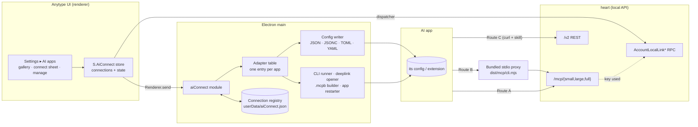

# Connect to AI: architecture

How the proposal in [README.md](README.md) maps onto anytype-ts, heart and anytype-mcp. Per-app values live in [apps.md](apps.md).

## 1. Components



- **Renderer.** It owns the UI and calls the key RPCs through the dispatcher, as the API Keys page does today (`C.AccountLocalLinkCreateApp`, `UpdateApp`, `RevokeApp`, `ListApps`). It passes the minted key to main once and never stores it.
- **Electron main.** The `aiConnect` module owns everything that touches other apps: detection, config writes, CLI runs, deeplinks, the `.mcpb` builder, restarts and the registry. Precedents already in the repo:
  - `electron/ts/lib/installNativeMessagingHost.ts` writes browser manifests and Windows registry keys;
  - `electron/ts/linkApproval.ts` runs the approval window.
- **heart.** No new endpoint is needed for Routes A–C. One addition is needed for real verification (§6).

Proposed files:

| Path | What |
|---|---|
| `electron/ts/lib/aiConnect/index.ts` | IPC entry points (`aiConnectDetect`, `aiConnectApply`, `aiConnectRemove`, `aiConnectRestartApp`, `aiConnectCheck`), wired in `electron/ts/api.ts` like the existing handlers |
| `electron/ts/lib/aiConnect/adapters/*.ts` | one file per app, implementing `Adapter` (§3) |
| `electron/ts/lib/aiConnect/writer.ts` | the config-writing contract (§7), with unit tests next to it (`writer.test.ts`) |
| `electron/ts/lib/aiConnect/mcpb.ts` | builds the Claude Desktop bundle (zip) |
| `electron/ts/lib/aiConnect/registry.ts` | connection registry + self-heal (§5) |
| `src/ts/component/page/main/settings/aiApps.tsx` | gallery + manage; registered next to `api` in `sidebar/page/settings/index.tsx` |
| `src/ts/component/popup/aiConnect.tsx` | connect sheet + finishing steps |
| `src/ts/store/aiConnect.ts` | MobX store: detected apps, connections, live state |
| `src/scss/page/main/settings/aiApps.scss`, `src/scss/popup/aiConnect.scss` | styles (nested selectors, per CLAUDE.md) |
| `src/json/text.json` | all strings |
| Storybook | gallery row, connect sheet, manage card, manual-setup card |

## 2. Key lifecycle

- **Mint.** `AccountLocalLinkCreateApp({ name, grant, expireAt? })` with `grant = { spaceIds, allSpaces, perm }`.
  - The name is the card's name ("Claude Desktop").
  - Scope is `JsonAPI`; `Command.ts` already sets it.
  - Keep `appHash` in the registry. The key itself only goes to main, for delivery.
- **Change access.** `AccountLocalLinkUpdateApp(appHash, grant)`. No rewrite needed, and open streams follow the grant live.
- **Reconnect.** Mint a new key, rewrite the entry, then revoke the old `appHash`, in that order so the app is never left keyless.
- **Disconnect.** Remove the entry, then `AccountLocalLinkRevokeApp(appHash)`. If the entry can't be removed (an unreadable file, or a Claude extension that can't be uninstalled programmatically), revoke anyway and tell the user what's left.
- **Shared files.** One key per config target (README §6). A second card reuses the first card's `appHash`.
- **API Keys page.** It lists these keys too, labelled "Created by AI apps", with a link back to the card. Revoking one there marks the connection "Access ended".

## 3. Client adapters

A declarative table: adding an app is a new entry plus a test, not new UI.

```ts
interface Adapter {
	id: string;                       // 'cursor'
	name: string;                     // translate key
	aliases: string[];                // ['windsurf'] for search
	icon: string;
	platforms: ('darwin' | 'win32' | 'linux')[];
	route: 'http' | 'stdio' | 'skill';        // default route
	routes: ('http' | 'stdio' | 'skill')[];   // allowed under Advanced
	defaultTier: 'large' | 'small';
	sharesWith?: string[];            // ['codex'] for chatgpt
	detect (): Promise<Detection>;    // { installed, version?, paths, cli? }
	plan (ctx: Ctx): Plan;            // what will happen, for the sheet text and the manual screen
	apply (ctx: Ctx): Promise<Result>;
	remove (ctx: Ctx): Promise<Result>;
	check (ctx: Ctx): Promise<Check>; // is our entry still there and correct?
	nextStep: 'none' | 'confirmInApp' | 'restart' | 'newSession' | 'reloadServer' | 'toggle';
	unsupported?: { reason: string; offer: string[] };   // ChatGPT web, Classic, …
};

interface Ctx { key: string; port: number; tier: string; proxy: ProxyCommand; os: NodeJS.Platform; };
```

- **One template, two outputs.** `plan()` returns the exact entry, target path and steps. The same object drives the sheet sentence, the automatic write, and the "Set up manually" screen, so the two can't drift apart.
- **Delivery order inside `apply()`:** the app's CLI → package → config merge → local deeplink. When nothing works, return `manual`.
- **CLIs:**
  - Run with `execFile` and an argument array, never a shell string.
  - Pass secrets on **stdin** where the CLI accepts it (`claude mcp add-json … -`); otherwise argv for the few CLIs that have no other way.
  - On macOS, resolve the binary with the user's login shell (apps.md §0.3).
- **Deeplinks:** `shell.openExternal(<custom scheme>)` only. No https trampolines when the link carries a key.
- **Restart (`aiConnectRestartApp`).** Only after a click:
  - macOS: `osascript -e 'quit app id "<bundle id>"'`, wait for exit, then `open -b <bundle id>`.
  - Windows: close gracefully (`taskkill /IM <exe>` without `/F`), wait, then start the detected path.
  - Linux: the restart button is hidden; the sheet tells the user.

## 4. The bundled proxy

### POC

- **Source.** `bin/cli.mjs` from anytype-mcp PR #168 (`thin-stdio-proxy`, 3.0.0). It's about 36 KB, has no runtime dependencies, and forwards each stdio message to `POST /mcp/<tier>`.
- **Packaging.** Copy it to `dist/mcp/cli.mjs` at build time, pinned by commit, and add `dist/mcp/**` to `asarUnpack` (the `.mcpb` builder reads it from there too).
- **Launch.** `process.execPath` with `ELECTRON_RUN_AS_NODE=1` and args `[<resources>/app.asar.unpacked/dist/mcp/cli.mjs, '--tier', <tier>]`, plus env `OPENAPI_MCP_HEADERS` and `ANYTYPE_API_BASE_URL` (apps.md §0.1). This is how VS Code's `code` CLI runs its own Node scripts. Note that `--tier` must be passed explicitly, because the proxy's default is `full`.
- **Claude Desktop.** The `.mcpb` carries the same `cli.mjs` and runs on Claude's built-in Node (`server.type: "node"`), so it doesn't depend on where Anytype is installed.
- **Test on:**
  - macOS hardened runtime, signed and notarized build;
  - Windows NSIS;
  - Linux deb/rpm/AppImage (the AppImage self-mount when spawned by another app);
  - Snap/Flatpak, where another app spawning ours may not be possible.

### Production

Replace the `ELECTRON_RUN_AS_NODE` launch with a **dedicated, signed helper binary** shipped next to `anytypeHelper`.

- **Candidates:**
  - heart's Go CLI `cmd/anytype`. It already has `anytype mcp --tier small|large` (stdio MCP) and task verbs with their own `SKILL.md`. It would need the `full` tier and the proxy's local file tools (`upload_local_file`, `download_file`).
  - a compiled build of the anytype-mcp proxy.
- **Why:**
  - The app can then keep Electron's "run as Node" fuse switched off as part of normal hardening (`electronFuses` in the build config).
  - One binary to sign and notarize.
  - A stable command name.
  - The Linux AppImage path problem goes away: the helper can live at a fixed per-user path that Anytype refreshes on start.

## 5. Self-heal

Registry file: `userData/aiConnect.json`. It holds no secrets.

```json
{
  "version": 1,
  "connections": [
    {
      "id": "chatgpt",
      "adapter": "chatgpt",
      "sharedWith": ["codex"],
      "appHash": "…",
      "route": "http",
      "tier": "large",
      "target": "~/.codex/config.toml",
      "entry": "mcp_servers.anytype",
      "port": 31009,
      "proxyPath": null,
      "createdAt": 0,
      "lastCheck": { "at": 0, "result": "ok" }
    }
  ]
}
```

**Runs:** at startup (after the account is open), when the API port changes (`AccountChangeJsonApiAddr`), and when the AI apps page opens.

For each connection:

1. Is the key still valid? Check `AccountLocalLinkListApps`. If it's gone or expired → **Access ended**.
2. Does `adapter.check()` find our entry?
   - Missing → **Removed in <app>**.
   - Present, but the port or proxy path is wrong → rewrite it silently. Set `nextStep` if the app needs a reload.
3. Is the file unreadable? → **Can't read <app>'s settings**.

Anytype never re-adds an entry the user removed inside the AI app. It asks first.

## 6. Verification

- **POC.** Right after delivery, main sends `initialize` + `tools/list` to `/mcp/<tier>` with the new key, or `GET /v2/auth/whoami` for Route C. That proves Anytype and the key work. The UI says **Added**, not **Connected**.
- **v1 (heart ask).** heart records per key `firstUsedAt`, `lastUsedAt`, and `lastClient`. `lastClient` comes from the MCP `initialize` `clientInfo` (`name`, `version`) and falls back to the `User-Agent`. heart serves these on `AppInfo` and sends `Event.Account.LinkAppUsed` on first use.
  - The waiting step listens for that event for the connection's `appHash`, then shows **Connected · "Cursor 3.18" made its first request**.
  - Manage shows "Last used".
  - Route C gets the same signal for free: every curl call carries the key.
- The proof is the app's own first request with its own key. A model saying "it works" doesn't count.

## 7. Config-writing contract

Every write follows this order. The Obsidian connector's Codex installer and JetBrains' auto-configure are the precedents ([research/tech-zero-config-precedents.md](research/tech-zero-config-precedents.md)).

1. **Resolve** the exact target from the adapter: env overrides (`CODEX_HOME`, `COPILOT_HOME`, `CLINE_MCP_SETTINGS_PATH`), pointer files (LM Studio), the MSIX glob (Claude).
2. **Read and parse** with the right parser. If parsing fails, **stop**, never start from `{}`. Return `manual` with the path.
3. **Back up** to `<file>.anytype-backup` (keep one; replace it on each write).
4. **Merge only our entry.** Keep unknown keys, other servers, comments and formatting:
   - JSON / JSONC: `jsonc-parser`'s `modify()` + `applyEdits()` keeps comments and layout.
   - TOML (`~/.codex/config.toml`): text edit of our `[mcp_servers.anytype]` table only. Remove the old table span up to the next header, append the new one, then **re-parse the result** with a TOML parser before writing. Never re-serialise the whole file.
   - YAML (Goose, Hermes): `yaml`'s Document API, which keeps comments.
5. **Write atomically:** a temp file in the same directory, `fsync`, rename. Keep the original file mode; create new files `0600` and new directories `0700`.
6. **Read back** and confirm the entry is there.
7. **Never log** contents, keys, or diffs that contain keys.

Writes to apps that rewrite their own file while running (Claude Desktop) happen only while the app is closed (quit → write → relaunch).

Remove follows the same steps: delete only our entry and leave everything else as it is.

## 8. Security

- **Key at rest.** It's plain text in the AI app's own settings, as every MCP client stores headers today.
  - **Mitigations now:** one key per app, scoped spaces and access, optional expiry, revoke in one click, `0600` on files we create.
  - **Later (v2): credential helpers** that keep the key out of other apps' files:
    - Claude Code `headersHelper`;
    - Codex `http_headers_helper` ("supported only for locally connected HTTP MCP servers");
    - the proxy reading a key file (proposed `ANYTYPE_API_KEY_FILE`).
    - Each one points at the bundled helper, which reads the key from a protected per-user store (`electron/ts/safeStorage.ts` already exists for app secrets).
- **Keys never travel through the web.** `anytype://ai/connect?app=…` carries no key. Local deeplinks with a key are a fallback only, opened directly by Anytype, and preferably with a read-only or expiring key.
- **Argv.** Prefer stdin or a file for secrets passed to CLIs.
- **Loopback server.** Keep heart's Origin check (native clients send no Origin) and bind to loopback only. Two hardening items:
  - Add a Host-header allow-list (`127.0.0.1:<port>`, `localhost:<port>`) against DNS rebinding.
  - Return a clear JSON 401 body for a bad or revoked key. Without it, some clients (Gemini CLI) fall back to OAuth discovery.
- **No OAuth in v1.** Reasons in [research/tech-auth-loopback.md](research/tech-auth-loopback.md):
  - The spec wants an HTTPS authorization server.
  - Clients differ on accepting loopback.
  - Cursor drops configured headers when OAuth metadata exists.
  - Revisit if clients converge.

## 9. Asks to other teams

### heart

1. **Per-key usage** for verification: `firstUsedAt` / `lastUsedAt` / `lastClient` on `AppInfo`, plus `Event.Account.LinkAppUsed` on first use (§6).
2. **`anytype-api` skill** (`core/api/v2/SKILL.md`):
   - if `ANYTYPE_API_URL` / `ANYTYPE_API_KEY` are set, use them and skip pairing;
   - build requests as `-H "Authorization: Bearer $ANYTYPE_API_KEY"`;
   - never print, echo or log the variables, and avoid `curl -v`.
3. **MCP compatibility.**
   - Today a request whose `MCP-Protocol-Version` header isn't 2025-06-18 or 2025-11-25 gets 400. Check 2026‑07‑28 clients against that. They should get the negotiated older version, not an error.
   - Add the Host allow-list and the JSON 401 body from §8.
4. **Production helper:** `full` tier and local file tools in `cmd/anytype mcp`, or agreement that the proxy binary is the helper (§4).
5. **Later:** an opt-in listen option for containers (Open WebUI in Docker).

### anytype-mcp (PR #168 / 3.0.0)

1. Build an artifact for desktop bundling (`cli.mjs` + version file).
2. Accept `ANYTYPE_API_KEY` (single secret) and `ANYTYPE_API_KEY_FILE` in addition to `OPENAPI_MCP_HEADERS`.
3. Ship an `.mcpb` manifest template matching apps.md §1.1, so Anytype only fills in values.
4. Republish the MCP registry entry (stale at 1.0.7) with the current `server.json` schema, from CI.
5. Point the README's install buttons at `anytype://ai/connect?app=…`.

### Developer portal / website

- "Connect to X" buttons open `anytype://ai/connect?app=<id>`, which opens the Connect sheet in the app.
- Update the "Add to LM Studio" and "Add to Cursor" badges that carry the old npx entry.

## 10. Analytics

Opt-in aggregate events, with no space names, keys, paths or content:

- `AiConnectOpen`
- `AiConnectStart {app, route}`
- `AiConnectDelivered {app, method: cli|package|config|deeplink|manual}`
- `AiConnectNextStep {app, step}`
- `AiConnectConnected {app, secondsToFirstUse}`
- `AiConnectFailed {app, stage, category}`
- `AiConnectRemoved {app, by: user|selfheal}`
- `AiConnectUnsupportedShown {app}`

The main metric is the share of `Start` that reach `Connected`, and the time it takes, per app and OS.

## 11. Test plan

- **Unit** (`electron/ts/lib/aiConnect/*.test.ts`, vitest):
  - writer: JSONC with comments, TOML with other tables and comments, YAML, an unparseable file, a missing file and directory, file modes, atomic replace, remove-only-ours;
  - each adapter's `plan()` per OS.
- **Adapter smoke matrix** on clean macOS, Windows and Linux VMs, per Release 1 app: detect → connect → first request seen → port change → self-heal → disconnect. Include the "test before ship" list in README §12.
- **E2E** (`../anytype-desktop-suite`, after implementation, per the qa-engineer flow):
  - gallery;
  - connect sheet defaults;
  - manual-setup screen content;
  - manage → change access;
  - disconnect revokes the key (visible on the API Keys page).
